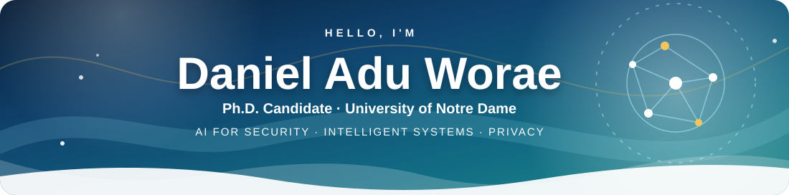
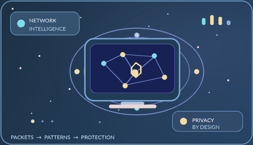

<!-- Daniel Adu Worae | @WadElla — Aurora edition
     Original visuals in /assets. Public work only; private initiatives are not named.
     For your profile, create a public repo named WadElla/WadElla. -->

<picture><source media="(prefers-color-scheme: dark)" srcset="./assets/aurora-header-dark.svg" /></picture>

 

 

<table>
<tr>
<td width="56%" valign="middle">

<h3>👋 A little about me</h3>

I'm <strong>Daniel Adu Worae</strong>, a Ph.D. candidate in <strong>Computer Science and Engineering at the University of Notre Dame</strong>.

My research brings together <strong>AI for cybersecurity, IoT security and privacy, and intelligent systems</strong> — interpreting network behavior, detecting threats, protecting sensitive information, and making AI-assisted security decisions more trustworthy.

<em>Curious about the packets. Serious about the impact.</em>

</td>
<td width="44%" valign="middle" align="center">

</td>
</tr>
</table>

## ✨ Featured Research & Open Source

🛰️ **[Revelation](https://github.com/WadElla/Revelation)** — AI agents for evidence-grounded interpretation of IoT traffic.

🛡️ **[IoT Shepherd](https://github.com/WadElla/iot-shepherd)** — Intelligent IoT management, threat detection, and grounded incident response.

🎛️ **[Adaptive Traffic Camouflage](https://github.com/WadElla/Adaptive-Traffic-Camouflage)** — Adaptive, resource-aware defense against IoT device fingerprinting.

🌐 **[IoT Traffic Camouflage](https://github.com/WadElla/IoT-Traffic-Camouflage)** — Practical traffic obfuscation for network privacy.

🧠 **[NEXUS-MI](https://github.com/WadElla/NEXUS-MI)** — Communication-aware federated personalization for brain–computer interfaces.

🔐 <strong>Additional Research Interests:</strong> Cryptography · Blockchain

## ☘️ Proudly Fighting Irish

Researching and building at the **University of Notre Dame** — connecting **AI, cybersecurity, network privacy, and intelligent systems**.

## 💌 Let's Connect

 

<picture><source media="(prefers-color-scheme: dark)" srcset="./assets/aurora-footer-dark.svg" /></picture>

